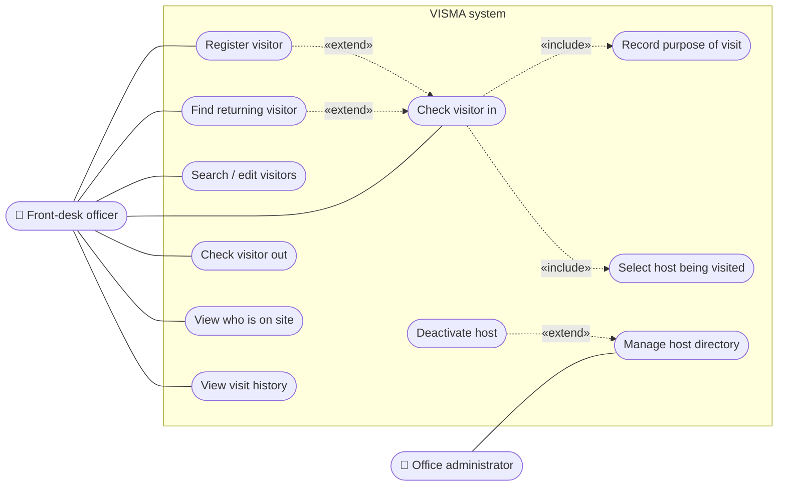
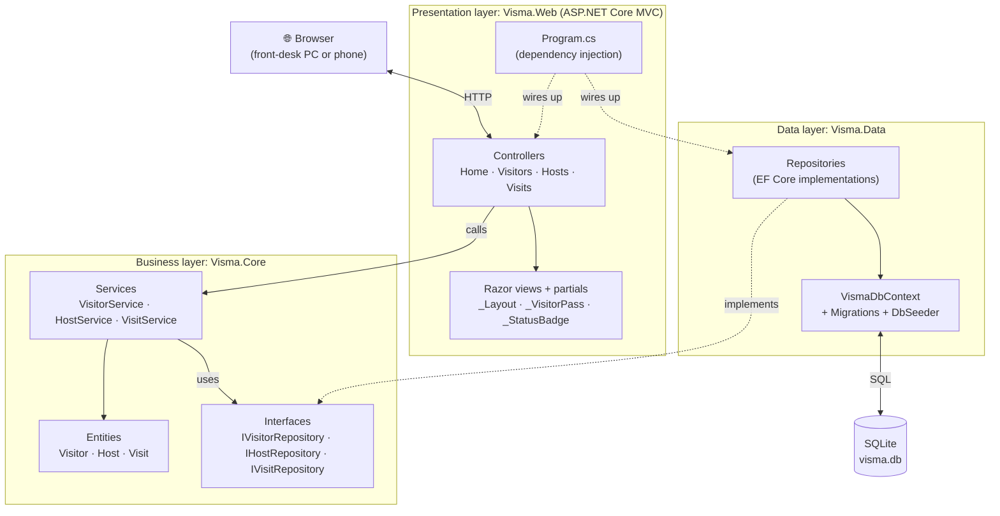
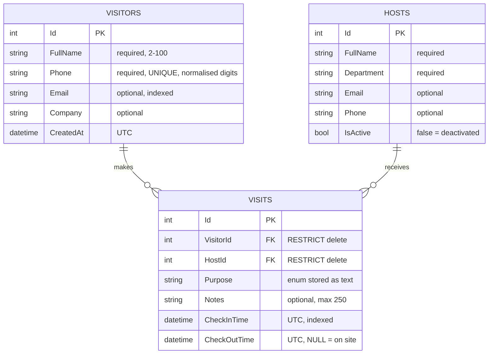
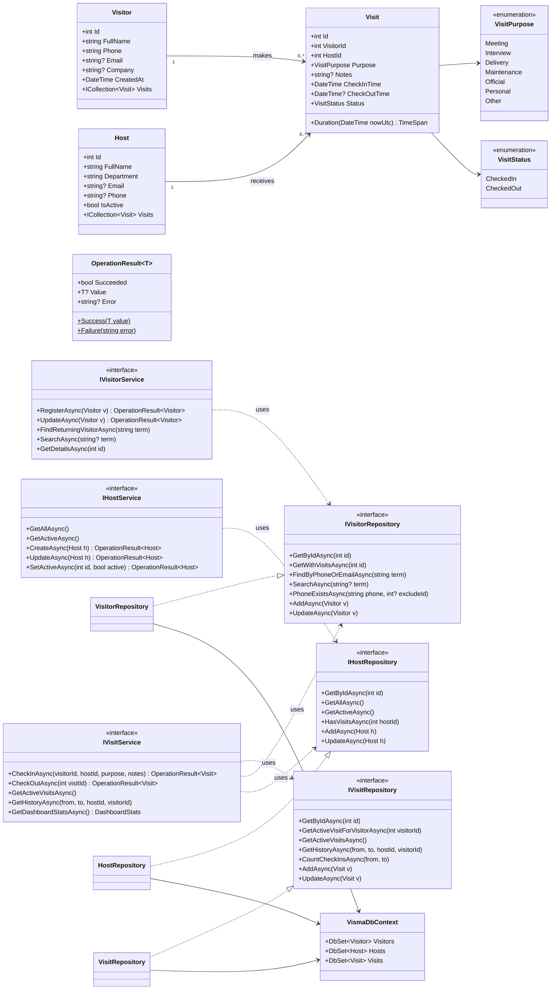
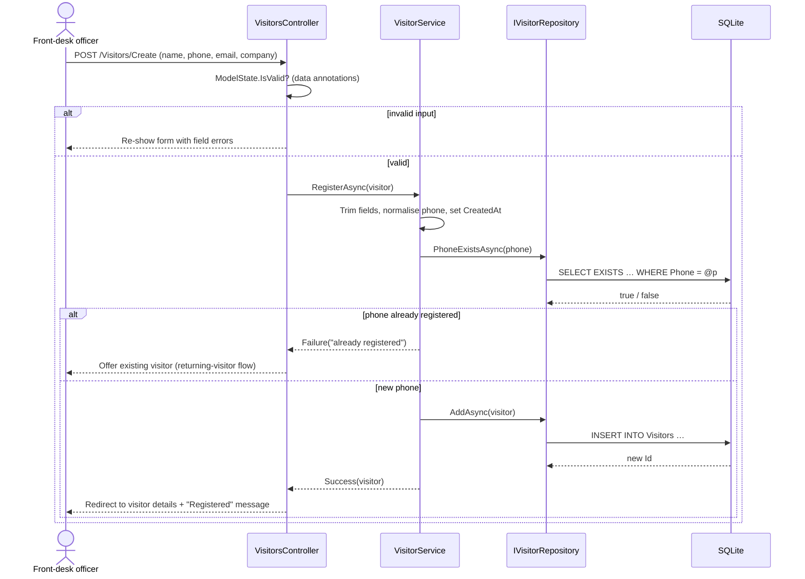
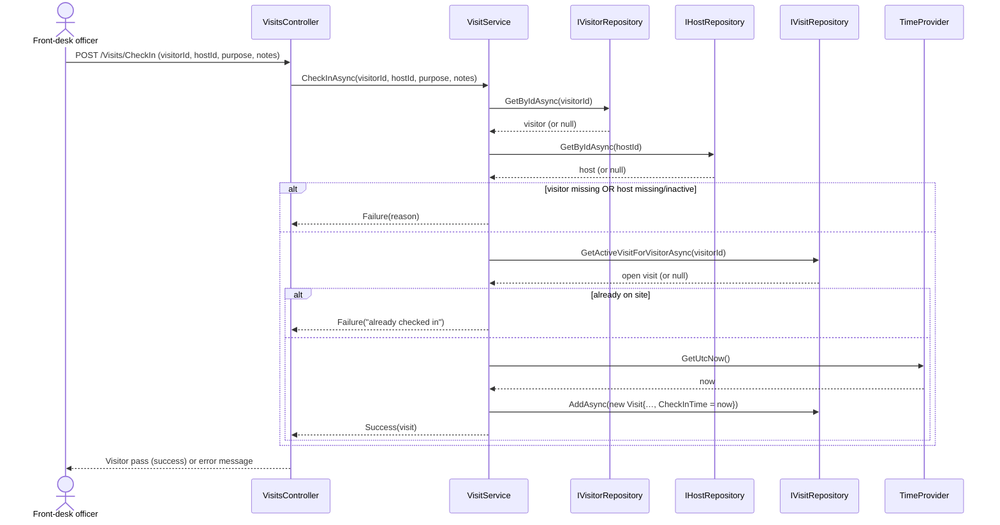
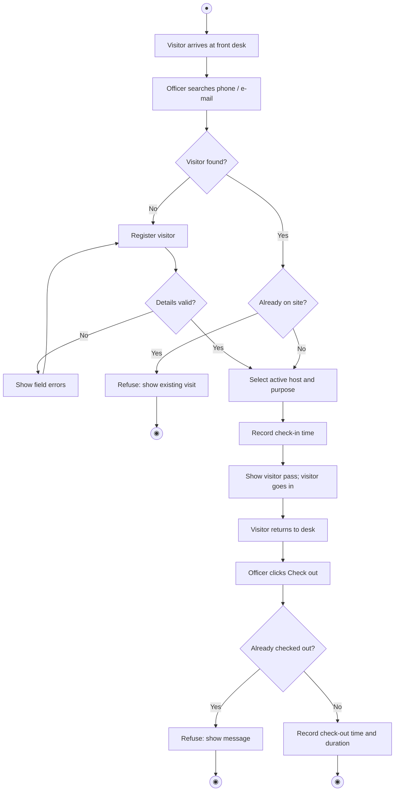

# 03: System Modelling and Design

All diagrams are written in [Mermaid](https://mermaid.js.org/), which GitHub renders automatically.
**For the PDF report:** paste each diagram into <https://mermaid.live>, then use *Actions → PNG* to export it.

| Diagram | Status | Owner |
|---|---|---|
| Use case | Final | Person 1 |
| Layered architecture | Final | Person 1 |
| Entity–relationship (data storage) | Final | Person 1 |
| Class | Final for Core/Data; services added by P2/P3 | Person 1 (+ P2, P3) |
| Sequence: register visitor | **Draft**: confirm against your code | Person 2 |
| Sequence: check in | **Draft**: confirm against your code | Person 3 |
| Activity: visit lifecycle | **Draft**: confirm against your code | Person 3 |

---

## 1. Use case diagram

Mermaid has no native UML use-case notation, so actors are drawn as nodes on the left and use cases as rounded nodes inside the system boundary.

## 2. Layered architecture

**Rules of the architecture**

- Controllers never touch `VismaDbContext` directly; they call services (or, for simple reads, repository interfaces).
- `Visma.Core` references no other project, so business rules can be unit-tested without a web server or database.
- All bindings between interfaces and classes live in `Program.cs`.

## 3. Entity–relationship diagram (data storage)

Indexes: `IX_Visitors_Phone` (unique), `IX_Visitors_Email`, `IX_Visits_CheckInTime`, `IX_Visits_VisitorId_CheckOutTime` (speeds up the double check-in rule and the on-site list), `IX_Visits_HostId`.

## 4. Class diagram

> **P2/P3:** when your `VisitorService`, `HostService`, `VisitService` and controllers exist, add them here
> (`VisitorService ..|> IVisitorService`, `VisitorsController --> IVisitorService`, …).

## 5. Sequence diagram: register a new visitor (DRAFT, Person 2)

## 6. Sequence diagram: check a visitor in (DRAFT, Person 3)

## 7. Activity diagram: visit lifecycle (DRAFT, Person 3)

